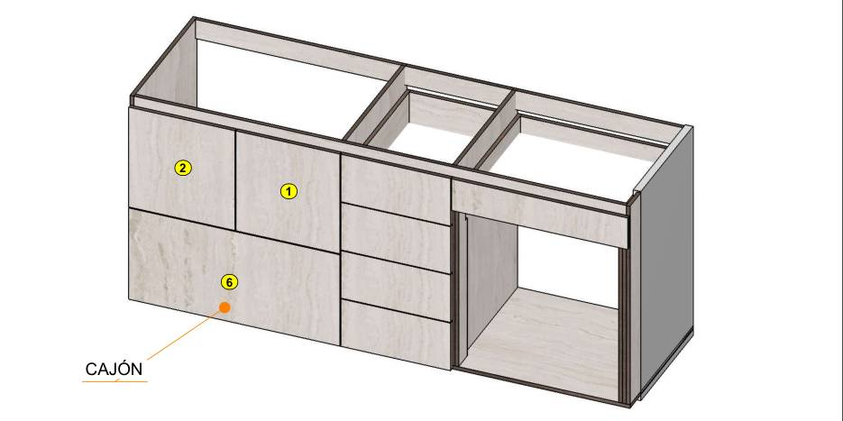

# Armado de muebles

App web para armar muebles de melamina pieza por pieza: identificas cada pieza por sus medidas, la ves en 3D dentro del mueble, llevas el checklist, optimizas el corte de tableros y estimas costos.

**En línea:** https://judasane.github.io/armado-muebles/



## Qué trae

| Pestaña | Qué hace |
|---|---|
| **Escanear** | Escribes las medidas de la etiqueta (la línea "1 / 1 de 532 x 370") y te dice qué pieza es, de qué mueble y dónde va. |
| **3D** | Modelo interactivo de cada mueble. Doble toque o deslizadores para abrir puertas, cajones y la cama; ocultar piezas o conjuntos; medir en cm (distancias ortogonales entre caras, aristas o esquinas). |
| **Despiece** | Todas las piezas con medidas, nombre en el plano, código y en qué conjunto van. |
| **Corte** | Optimización de corte en guillotina (disco, refilado, veta, tamaño de tablero), material/color por pieza, revisión de holguras antes de cortar y costo aproximado. |
| **Planos** | Los planos originales con el ítem marcado. |
| **Checklist** | Cuántas piezas de cada una ya encontraste. |

**Muebles:** cocina y TV (despiece de Madecentro), armario (despiece inferido de los planos) y 2 propuestas con los cajones en una columna (A y C), cama abatible IBIZA (Tecnomobili CM-8043) y 4 variantes de diseño de la cama: con pistones, eléctrica, vertical y con escritorio que siempre queda horizontal.

Pensada para personas daltónicas: nada se distingue solo por el color (siempre hay ícono, palabra, patrón o diferencia de luminancia).

## Usarla

- **En el celular o el computador:** abre el enlace de arriba. No necesita instalación ni cuenta.
- **Leer la etiqueta con foto** y el **checklist compartido** entre dispositivos usan Claude y solo funcionan si la app se abre como Artifact en claude.ai (ver `tools/empaquetar.mjs`). En GitHub Pages se usa la entrada por medidas y el checklist queda guardado en ese navegador.

## Desarrollo

No hay paso de compilación ni dependencias: es HTML, CSS y JavaScript plano; three.js r128 se carga desde CDN con SRI.

```bash
python3 -m http.server 8000      # y abre http://localhost:8000
```

```bash
node tools/check.mjs             # revisión automática (corre también en GitHub Actions)
```

```bash
node tools/empaquetar.mjs        # dist/armado-muebles.html: todo en un archivo, para claude.ai
```

```bash
node tools/sellar.mjs            # después de cambiar css/ o js/: actualiza los ?v= de index.html
```

### Estructura

```
index.html          marcado de la app (pestañas, visor, diálogos) y orden de carga de los scripts
css/app.css         estilos (tema claro y oscuro)
js/armarios.js      propuestas de armario (geometría por zonas; el despiece se deriva de ella)
js/catalogo.js      piezas (P), nombres en el plano, marcas de los planos, variantes de la cama
js/ui.js            checklist, ficha de pieza, búsqueda por medidas, escaneo, despiece, planos
js/modelo.js        geometría de cada mueble en mm (sin three.js), conjuntos, herrajes y mecanismos
js/visor3d.js       visor 3D con three.js: carga, animación, selección, capas, deslizadores
js/medidor.js       medidor ortogonal
js/corte.js         optimizador de corte, revisión de holguras y costos
js/arranque.js      estado inicial y conexión opcional con Claude
assets/planos/      imágenes de los planos y vistas
tools/check.mjs     revisión: sintaxis, catálogo vs 3D, choques, mecanismos, datos personales
tools/empaquetar.mjs  arma el HTML de un solo archivo
```

Antes de tocar el código lee **[AGENTS.md](AGENTS.md)**: explica el modelo de datos, las coordenadas, las reglas de diseño y cómo agregar un mueble.

### Publicar

Cada push a `main` se publica solo en GitHub Pages (rama `main`, carpeta raíz). La revisión corre en GitHub Actions en cada push y pull request.

## Avisos

- Los mecanismos de las variantes de la cama (pistones, actuadores, escritorio con paralelogramo) son cálculos propios, no del fabricante. Revísalos con alguien que trabaje herrajes antes de construirlos, y ancla siempre el mueble a la pared.
- Los precios salen de una cotización de Madecentro de septiembre de 2026; cambian con el tiempo.
